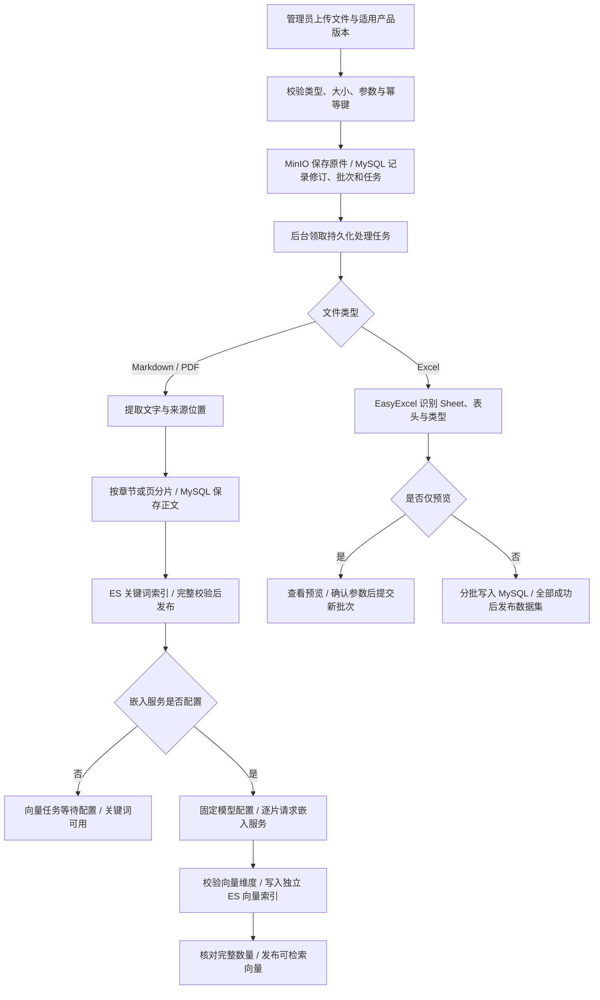
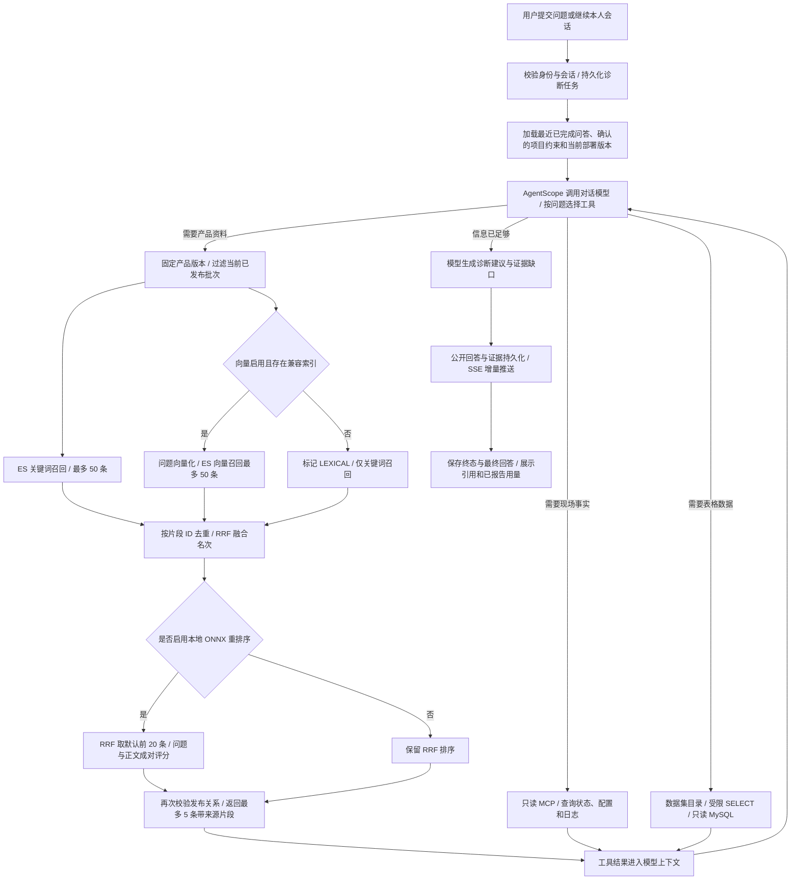
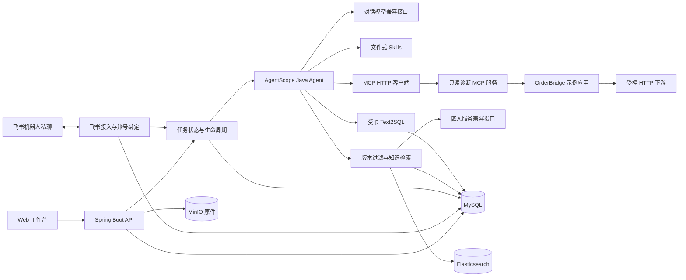

# SupportOps

**面向软件实施与技术支持人员的 Java Agent 诊断工作台。**

把现场报障、产品文档和只读诊断工具连接起来，形成带来源的事实、候选原因、人工处理建议和证据缺口。主要用于工单受理之后、研发深入处理之前的初步排查。

提供本地 OrderBridge 示例和单企业独立部署两种运行方式。企业管理员配置项目、系统、环境及标准只读源，人员按授权目标诊断，已有系统通过应用 API 集成。企业接入操作见[使用手册](docs/enterprise-integration.md)，离线安装和恢复见[独立部署](docs/enterprise-deployment.md)。完整工单、复杂角色、自动修复、多 Agent 和技能市场见 [版本路线图](ROADMAP.md)。

支持通过 Web 工作台或[飞书机器人私聊](#飞书机器人接入)提交问题。飞书入口使用企业自建应用，绑定工作台账号后即可在私聊中接收诊断结果；完整问答、证据和用量统一保留在工作台。

> 模型诊断需要自行配置兼容接口的服务密钥。未配置时，应用提供文档管理、关键词检索和故障环境操作，并明确显示诊断不可用。固定协议测试用于验证工程链路，不代表真实模型诊断准确率。

## 演示

https://github.com/user-attachments/assets/669a565e-0aa1-4b21-9b5a-3c141856840b

**79 秒排障演示** · 点击上方播放器即可观看 · 中文字幕 · 无配音 · [场景说明与字幕](docs/demo/README.md) · [下载 MP4](https://github.com/laohandong/supportops/raw/refs/heads/main/docs/demo/supportops-demo-zh.mp4)

从升级后同步失败开始，展示文档索引、MCP 现场取证、适用版本检索与引用、人员处理，以及再次诊断确认本次请求恢复。画面来自自建 OrderBridge 合成环境中的真实操作和模型回答，推理等待片段已标注加速。

## 典型问题

“升级到 2.0 后订单同步持续失败，路径配置看起来没有变化。”

实施人员需要核查的是这个产品在这个现场的事实：当前版本读取哪个配置键、实际生效值是什么、失败请求访问哪个路径、下游返回什么，以及迁移说明是否适用。SupportOps 用 MCP 获取当前事实，用适用的资料解释产品行为；诊断助手提出建议，由人员处理，再用新的请求验证结果。

## 功能

| 模块 | 当前实现 |
| --- | --- |
| Agent | AgentScope Java 单 Agent，多轮工具调用；百炼、DeepSeek、OpenAI 与自定义兼容接口按配置选择 |
| Harness | 异步任务、默认最多 10 轮和 120 秒超时、主动取消、终态保护与重启中断标记 |
| MCP | Streamable HTTP，四个固定的只读诊断工具 |
| 企业接入 | 项目/系统/环境、成员与环境授权、不可变连接草稿、测试与启用、标准只读 REST、系统资料范围和独立 Java 接入样例 |
| 开放 API | 独立应用身份、环境与权限授权、一次性访问密钥、轮换与撤销、固定请求异步受理、事件与结果读取、取消及额度 |
| 企业部署 | Linux 专属离线 Compose、HTTPS 与 Secret 挂载、凭据加密、单实例保护、主密钥轮换、停写冷备份与新部署恢复 |
| 文档 | Markdown、文字型 PDF、Excel 上传；单文件最多 20 MiB，原件存入 MinIO，保留上传、修订和处理历史，自定义分片与重叠 |
| 检索 | Elasticsearch 关键词与向量召回、RRF 初筛、可选本地 ONNX 模型精排、服务端版本过滤；Excel 使用 MySQL 只读 Text2SQL |
| 后台处理 | Java 21 虚拟线程、持久化任务、状态与进度、租约恢复、失败定时补偿和人工重试 |
| Skills | 两个内置文件式排障 Skill，按需加载，不开放脚本执行 |
| 项目记忆 | 人员显式确认的项目约束；跨会话加载、查看和删除 |
| 用量分析 | 输入／输出堆叠柱状图、累计与每轮平均用量折线图、高消耗会话图；保留 UTC 小时／天明细、Token Top 20、历史问答与执行证据回看，区分未报告用量 |
| 用户 | 首次创建管理员、密码登录和退出；管理员创建账号；普通用户仅访问自己的对话；诊断与上传记录保存用户归属 |
| 处理结果与评测来源 | 人工回填、不可变修订、固定请求恢复与脱敏来源导出，见 [使用文档](docs/diagnosis-outcomes.md) |
| 评测集成 | 人工确认的脱敏来源 JSON、固定被测程序包及旧接口兼容，见 [集成说明](docs/evaluation-split.md) |
| 受控修复 | 内置合成 OrderBridge 固定迁移、单管理员审批、一次执行、独立 HTTP 验证、审计和 UNKNOWN 核查，见 [使用文档](docs/controlled-remediation.md) |
| 工作台 | SSE 流式回答、Markdown 渲染、证据分类、历史诊断、会话逻辑归档、JSON 导出、模型配置和示例环境操作 |
| 飞书机器人 | 企业自建应用长连接、文字私聊诊断、一次性账号绑定与撤销、异步结果回复、收件去重、持久化投递与有限重试 |
| 验证 | HTTP/MCP、生命周期、真实隔离持久化与浏览器回归 |
| 可靠性运维 | 实际 JAR/PID/就绪身份、管理员只读运行信息、doctor/status、真实浏览器回归与专属部署停写备份/恢复，见 [运行文档](docs/reliability-delivery.md) |

诊断、文档片段、上传与修订历史、任务状态和项目约束通过 MyBatis-Plus 保存在 MySQL。Excel 各 Sheet 使用独立的带类型关系表，原件保存在 MinIO 私有桶，文本和向量索引保存在 Elasticsearch。示例应用使用内存状态，重启后恢复为默认升级故障；正在执行的诊断标记为中断，知识处理任务按持久化租约恢复。

## 快速启动

需要 JDK 21、Node.js 22.x、已启动的 Docker Engine / Docker Desktop，以及 Docker Compose 2.20+。项目包含 Maven Wrapper，首次构建和拉取镜像需要联网；网页运行本身不依赖 Node.js。

以下命令用于本地示例。企业安装使用[独立部署手册](docs/enterprise-deployment.md)中的离线包与 HTTPS 初始化流程，存储不开放宿主机端口；模型和连接默认关闭，须由管理员明确批准。

根目录 [docker-compose.yml](docker-compose.yml) 一次启动 MySQL、MinIO、Elasticsearch 三项依赖，默认回环端口为 13306、19000、19200；Java 应用在本机运行。环境要求、依赖用途、完整操作步骤、端口调整和故障排查见 [本地部署与启动依赖](docs/deployment.md)。

首次启动时，应用会自动创建业务表、索引和必要的初始数据，无需手动导入 SQL。启动完成后，打开工作台创建管理员账号即可使用。已有数据库的版本升级、手动初始化或历史数据导入，请参阅 [数据库维护](docs/database.md)。

推荐构建 JAR 后通过 Node 脚本启动，以加载 `.local/model.env`。以下快速启动跳过测试；完整验证需先准备独立测试依赖，见下方“测试与评测”。

Windows PowerShell：

```powershell
# 确保 JAVA_HOME 指向 JDK 21。
docker compose up -d --wait --wait-timeout 180
node scripts/setup-local.mjs
.\mvnw.cmd -s .mvn/settings.xml -DskipTests package
node scripts/start.mjs
```

macOS / Linux：

```bash
docker compose up -d --wait --wait-timeout 180
node scripts/setup-local.mjs
sh ./mvnw -s .mvn/settings.xml -DskipTests package
node scripts/start.mjs
```

`setup-local.mjs` 创建匹配 Compose 的 `.local/model.env`，已有文件会保留。默认关闭向量与本地重排序，无需模型密钥即可首次启动。公开合成存储账号只用于本机演示；完整配置项另见 [.env.example](.env.example)。

打开 [本地工作台](http://127.0.0.1:18080)，按页面引导创建首个管理员；已有账号时进入登录页。没有预置默认密码。业务数据位于上述存储服务；本地模型设置和运行日志位于 `.local/`，该目录不纳入版本控制。停止应用使用终端的 Ctrl+C，停止依赖使用 `docker compose stop`，数据卷保留。

侧栏按场景分为“客户工作区”和“后台管理”：诊断工作台、新建会话与最近诊断位于客户工作区；知识文档、项目约束、企业接入、修复中心、示例环境、用量分析、模型配置、用户管理及飞书机器人位于后台管理。管理员可访问全部菜单并创建账号；普通用户仅可使用客户工作区并查看自己的对话。操作与权限见 [用户系统](docs/users.md)。

`node scripts/start.mjs` 使用独立 JAR 副本，避免占用构建产物。开发调试也可使用 Maven `spring-boot:run`，但它不读取 `.local/model.env`，数据库与存储等参数必须另行设置为进程环境变量。

### 后端接口文档

应用内置 [Swagger UI](http://127.0.0.1:18080/swagger-ui/index.html)，覆盖已实现的业务接口，按业务模块分组，提供中文用途、请求参数、响应字段、枚举含义、错误码和调用示例。业务接口统一使用 GET 查询、POST 执行写操作。查看文档不需要模型密钥。

Swagger 与 OpenAPI 定义仅管理员登录后可访问。机器可读定义位于 [OpenAPI JSON](http://127.0.0.1:18080/v3/api-docs) 和 [OpenAPI YAML](http://127.0.0.1:18080/v3/api-docs.yaml)。调用顺序、状态处理和密钥说明见 [后端接口文档](docs/api.md)。

### 配置模型

管理员在侧边栏打开“模型配置”，选择服务商，填写接口地址与 API 密钥，点击“获取可用模型”选择准确的模型 ID（也可手动填写），按需设置对话推理等级，点击保存即可生效，无需修改配置文件或重启。对话与向量服务分别保存，内置百炼、DeepSeek、OpenAI 与自定义兼容接口。诊断运行期间不能修改配置。

界面配置优先于文件与环境变量，保存在 `.local/model-settings.json`；其中的密钥未加密，不会回显到页面，不应共享或提交该目录。切换服务商或接口地址后需填写对应密钥，旧密钥不会沿用。“恢复文件配置”可删除当前角色的界面覆盖值。

文件配置适用于脚本运行和高级参数：`.local/providers.yml` 保存服务商定义，`.local/model.env` 保存本地环境变量。示例见 [.env.example](.env.example) 和 [providers.example.yml](providers.example.yml)。

**向量服务为可选配置。** 启动应用、上传与分片文档、关键词检索、项目记忆管理均不要求模型密钥。普通 Agent 诊断和默认关键词评测只要求对话密钥；建立向量索引及混合检索评测才要求向量密钥。未配置向量服务时，普通检索明确使用 `LEXICAL`，不会因此阻止诊断。

例如，使用 DeepSeek 对话并禁用向量服务，在 `.local/model.env` 中设置：

```dotenv
SUPPORTOPS_MODEL_PROVIDER=deepseek
DEEPSEEK_API_KEY=填写本地密钥
SUPPORTOPS_EMBEDDING_PROVIDER=disabled
```

选择 OpenAI 时使用 `SUPPORTOPS_MODEL_PROVIDER=openai` 与 `OPENAI_API_KEY`；选择百炼时使用 `bailian` 与 `DASHSCOPE_API_KEY`。只填写实际使用的平台密钥，切换 Provider 不会回退读取另一平台的密钥。原有 `SUPPORTOPS_API_KEY` 等覆盖变量仍可使用；切换时应清除不再适用的旧地址、模型和密钥覆盖值。

工作台启动脚本读取 `.local/model.env`，直接通过 Java 或 Maven 启动时需要自行设置进程环境变量。应用自动加载 `.local/providers.yml`，文件修改后重启生效。AgentEval使用自己的模型档案，不读取工作台设置。自定义 Provider、参数兼容性与完整示例见 [模型服务配置](docs/providers.md)。

当前对话适配器使用 Chat Completions 的流式响应与工具调用；嵌入请求发送至 `/embeddings`。接口兼容性不等于覆盖所有模型特性，Responses 与 Anthropic Messages 协议尚未实现。运行结果及所检索的片段会进入模型上下文；建立索引时，文档片段会发送给配置的嵌入服务。

### 飞书机器人接入

飞书机器人入口已完成本地 SDK 协议、隔离数据库及管理页面验证，并以指定测试账号完成真实应用鉴权、长连接、私聊绑定、诊断受理、结果送达和撤销后的拒绝检查；网络故障下的自动重连尚未通过故障注入验证。应用通过官方 Java SDK 建立 WebSocket 长连接，接收用户发给机器人的文字私聊，并通过消息接口返回受理提示和诊断结果，无需公网回调地址。该入口沿用工作台的对话模型、知识检索、只读诊断工具和记录归属，具体证据与范围见[验证记录](docs/validation.md#2026-09-23-诊断时间展示与原文留存)。

在飞书开放平台创建企业自建应用并启用机器人能力，申请接收用户单聊消息和以应用身份发送消息的权限。事件订阅选择 **接收消息 v2.0**（`im.message.receive_v1`），接收方式选择长连接，并将应用可用范围设置为实际使用人员。

在本机 `.local/model.env` 填写以下配置，已有同名项应直接修改：

```dotenv
SUPPORTOPS_FEISHU_ENABLED=true
SUPPORTOPS_FEISHU_APP_ID=你的应用编号
SUPPORTOPS_FEISHU_APP_SECRET=你的应用密钥
SUPPORTOPS_FEISHU_TENANT_KEY=你的企业编号
```

飞书入口默认关闭；连接配置修改后需要在无活动诊断时重启服务。`TENANT_KEY` 填写应用所属企业的 tenant key。飞书复用工作台统一的对话模型、向量服务及检索策略，无需单独配置检索开关：向量服务已配置且存在适用索引时使用混合检索，否则使用关键词检索；向量调用失败会明确报错。网页聊天框中的“仅关键词检索”只作用于当前网页提交的诊断。

1. 使用 `node scripts/start.mjs` 启动已打包应用，在后台“飞书机器人”查看连接状态。需要先建立连接才能保存事件订阅时，先启动服务，再保存飞书后台配置并发布应用版本。
2. 管理员在“用户管理”创建工作台账号，再进入“飞书机器人”，选择该账号并生成绑定命令，通过可信渠道交给对应人员。
3. 使用者在机器人的私聊中发送绑定命令。命令十分钟内有效，只能使用一次；绑定成功后直接发送问题描述，例如“升级到 2.0 后订单同步持续失败”。
4. 机器人先返回受理提示和任务编号，诊断结束后发送结果。完整问答、引用证据和用量可在工作台查看；管理员可查看消息处理与投递状态，或撤销账号绑定。

每条消息创建独立诊断，当前同一时间只受理一个任务，忙碌时明确提示稍后重发。重复事件不会重复执行诊断；投递失败使用原回复和固定去重编号有限重试。长回答会标注节选，完整内容保留在工作台。

当前支持一个飞书应用、一个企业和单实例工作台，不支持群聊触发、附件解析、多轮私聊上下文或交互卡片。详细配置、绑定规则、恢复机制及数据库升级说明见 [飞书私聊诊断](docs/feishu.md)。

### 演示一次完整排查

1. 在“知识文档”中选择“导入示例文档”，导入 2.0 运行手册、迁移说明和 1.0 历史手册。
2. 等待文档解析和关键词索引完成。已配置嵌入服务时自动建立向量索引；未配置时显示等待处理条件，关键词检索仍可用。
3. 在“示例环境”选择“升级后配置未迁移”。系统会实际发起 HTTP 请求并记录失败响应。
4. 在诊断工作台使用“升级后订单同步失败”的示例问题，查看工具调用、参考片段及建议。
5. 从诊断或“示例环境”进入“修复中心”，审阅不可变提案并显式批准，再点击“执行已批准修复”。查看配置应用回执及新请求的 200、accepted=true 和请求身份；流程见 [受控修复中心](docs/controlled-remediation.md)。
6. 回到诊断页补充“已调整配置，请重新验证”，生成新的诊断记录。

该环境由本项目自建，订单、凭据和下游均为合成演示数据。MCP 只返回实际状态与请求记录，不返回场景名称或预设根因。切换故障、修改配置和发起业务同步均未作为工具开放给 Agent。

## 知识检索的作用

通用模型能够解释 HTTP 状态、Java 异常和常见配置问题。本项目的知识库补充产品专属规则：不同版本读取哪个键、默认值是什么、旧规则何时失效，以及怎样验证迁移结果。

### 文件上传到向量化



1. **受理与留存。** 上传记录保存请求归属、内容摘要和幂等键，原件保存在 MinIO 私有桶；MySQL 维护逻辑文档、不可变修订、处理批次和任务。HTTP 受理成功只表示进入处理流程。
2. **解析与分片。** Markdown 按标题、文字型 PDF 按页提取，再按 Unicode 码点窗口分片。默认上限 `chunkSize=100`、重叠 `overlap=10`，可在上传或重新处理时调整；重叠不跨章节或页。分片记录正文、文档及修订 ID、页码或行区间，尚不支持 OCR。
3. **先提供关键词检索。** 分片和 TEXT 任务在同一事务提交；后台写入 ES，完整校验后更新 MySQL 发布关系。解析成功、关键词可用和向量可用分别显示，上传完成不等于向量化完成。
4. **按配置生成向量。** 向量任务固定服务地址与模型配置，逐片生成并校验向量，写入按配置指纹和维度区分的 ES 索引；数量完整且当前发布关系仍匹配时才发布。缺少配置时仅向量阶段等待；服务调用失败会记录错误，按任务规则阻塞或重试，不发布部分索引。
5. **独立处理 Excel。** Excel 保留 Sheet、列类型、修订和原始行号，走关系表与受限 SQL 查询。预览批次不可查询；确认后提交正式处理批次，全部入表成功后发布，不经过文本向量化。

重新处理保留历史修订与批次；删除文档立即停止检索，再由后台清理外部存储，历史诊断证据不改写。参数、补偿与发布规则见 [知识存储与处理](docs/knowledge.md)。

### 用户提问到检索、重排序与返回



1. **确定上下文。** 每轮诊断创建独立 Agent，续聊加载最近三轮已完成问答和当前人工确认的项目约束。知识与 Excel 工具使用服务端固定的部署版本；适用资料为该版本或通用标记 `*`。
2. **按需取证。** Agent 根据问题选择 MCP、知识检索、Excel 查询与 Skill 加载，可多轮组合调用。并非每个问题都需要检索；Skill 和检索内容不能扩大工具权限。
3. **召回与融合。** 文本检索先过滤当前发布批次与版本，关键词始终参与；向量配置有效且有兼容已发布索引时，另将问题向量化并执行向量召回。两路各最多 50 条，按片段 ID 合并，用 RRF（常数 60）融合名次。无兼容向量时明确返回 `LEXICAL`；进入向量调用后的失败明确报错。
4. **可选重排序。** 开启 ONNX 时，RRF 先保留默认 20 条候选，本地模型对“问题＋片段正文”成对评分。关闭时直接沿用 RRF 顺序。两种路径都在返回前重新检查发布关系，最多提供 5 条片段；`score` 保留 RRF 分数，`rerankScore` 保存模型原始分数，二者都不是诊断置信度。`lexicalOnly` 只关闭向量召回，不关闭已启用的重排序；精排失败也不会静默回退。
5. **生成与交付。** 模型综合现场事实、资料片段、表格结果和项目约束，形成事实、候选原因、人工建议与缺口。引用保留文档、分片、修订、批次及原文位置；普通用户通过证据快照查看片段，原件管理入口仅管理员可用。执行期间公开回答和事件经 SSE 推送，结束后以持久化终态与最终回答为准；重连按游标续接，不重新执行诊断。

模型输出、工具调用和检索证据可交错产生；流程图表示数据依赖，实际执行允许多轮取证。模型文件、排序预算和错误说明见 [本地重排序](docs/reranking.md)，任务生命周期见 [架构说明](docs/architecture.md)。

关键词命中、向量相似度和引用存在都不等于结论正确。诊断效果需要在同模型、同资料与同预算下进行对照，并审阅引用是否真正支持结论。

## 与通用 Agent 的关系

资料齐全的一次性排障，直接使用通用 Agent 是合理选择。为其提供相同的文档、MCP 和 Skills，它也可能完成本项目的任务。

SupportOps 的价值在于把技术支持流程落成固定工作台：预接入现场证据、约束资料版本、保存诊断记录、复用项目约束，并用可复现环境验证执行边界。它不以“模型比通用 Agent 更聪明”为定位，也没有据此宣称诊断效果更优。

企业版已提供项目与环境授权及按系统的资料范围。统一工单、人员交接和更完整的质量追踪可继续扩展；当前工程验证与真实企业试点的结论分别记录。

## 架构



采用模块化单体，Agent 任务运行在 Java 虚拟线程中，独立于提交任务的 HTTP 请求。工作台通过 SSE 增量接收持久化回答片段和执行证据，断线后按事件游标续接；历史记录仍可通过查询接口读取。参考资料和日志不具备指令权限；只读工具范围由服务端注册表固定。

技术版本固定在 [pom.xml](pom.xml)：Java 21、Spring Boot 3.5.16、MyBatis-Plus 3.5.17、AgentScope Java 2.0.2、与其对齐的 MCP SDK 0.17.0，以及 PDFBox 3.0.5。业务模块内部采用 Controller、Service、Mapper 分层，数据库实体与请求、响应对象分别维护。内部模块、持久化方式和任务语义见 [架构说明](docs/architecture.md)，代码修改规范见 [AGENTS.md](AGENTS.md)。

## 测试与评测

Java 使用 JDK 21 和仓库内的 Maven Wrapper。在独立 MySQL、MinIO 与 Elasticsearch 已准备好的环境中执行：

```powershell
.\mvnw.cmd -s .mvn/settings.xml verify
node --test src/test/js/*.test.mjs
```

依赖隔离及端口配置见[部署说明](docs/deployment.md#隔离测试与评测)。验证覆盖持久化、H2 迁移、Excel、版本发布、任务生命周期、企业接入与飞书本地协议。缺少真实 ONNX 权重时，五项条件测试明确跳过；本地 HTTP 模型夹具仅验证工程协议。

SupportOps 向独立评测项目提供固定程序包与人工确认的脱敏来源，见[集成说明](docs/evaluation-split.md)。本仓库不包含评测平台的实现、模型档案和执行器；旧 `scripts/evaluate.mjs` 与 `evaluation/run.mjs` 以退出码 2 停止，不读取工作台密钥执行实验。

SupportOps 已通过 [PR #2](https://github.com/laohandong/supportops/pull/2) 合并到 `main`；合并提交 `5c0956132536cc51e0f021d44b7acc0b0e5286b0` 的 [GitHub Verify](https://github.com/laohandong/supportops/actions/runs/39248374704) 于 2026-10-19 通过，覆盖完整构建、真实隔离存储、浏览器和恢复矩阵。提交身份、检查范围与限制见 [主线验证记录](docs/github-validation-20261019.md)。2026-10-11 本地完整回归的逐项计数与 ONNX 跳过明细另见 [本地回归与提交准备记录](docs/supportops-validation-20261019.md)，不作为远端运行的测试数量。

## 使用边界

- 本地示例默认仅监听本机。企业包登记 HTTPS 来源、Host 和可信代理，采用项目成员与环境授权；一家企业一个部署、单应用实例，不提供共享 SaaS 多租户或高可用。
- 单一可变示例环境同时只接受一个诊断任务；运行期间阻止工作台更改故障条件。
- 项目记忆在任务开始时读取。删除只影响之后启动的任务，历史诊断不因此改写。
- 上传与重建异步执行；单文件最大 20 MiB、PDF 最多 500 页、文本最多 10000 个分片。Excel 最多 20 个选中 Sheet、200 列、100000 个非空行（含表头），并限制展开后的单元格与字符量。复杂表头需显式指定，公式必须有已保存的缓存值。
- 模型建议需要人工审阅。企业连接器只读，必须适配标准协议并明确授权；自动现场修复、工单状态机及专用厂商连接器属于后续范围。

## 文档导航

全部文档按使用、原理和维护分类，见 [文档目录](docs/README.md)。

| 内容 | 文档 |
| --- | --- |
| 部署、依赖与故障排查 | [本地部署与启动依赖](docs/deployment.md) |
| 定位、使用环节与范围 | [产品说明](docs/product.md)、[版本路线图](ROADMAP.md) |
| 数据处理与检索原理 | [知识存储与处理](docs/knowledge.md)、[本地重排序](docs/reranking.md)、[架构说明](docs/architecture.md) |
| 配置与接口 | [模型服务](docs/providers.md)、[用户系统](docs/users.md)、[API](docs/api.md) |
| 飞书机器人接入与账号绑定 | [飞书私聊诊断](docs/feishu.md) |
| 提案、审批与原执行核查 | [受控修复中心](docs/controlled-remediation.md) |
| 数据库初始化与历史升级 | [数据库维护](docs/database.md) |
| 验证与评测 | [主线验证记录](docs/github-validation-20261019.md)、[验证结果与范围](docs/validation.md)、[评测集成与兼容](evaluation/README.md) |

## 许可证

本项目采用 [Apache License 2.0](LICENSE)。
