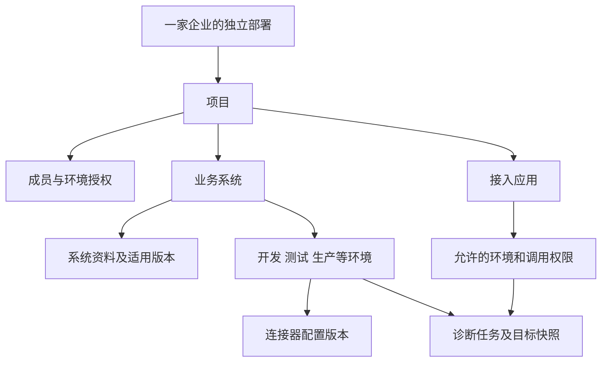

# 企业独立部署与系统接入 V1 设计

日期：2026-10-04。状态：企业接入实现契约；核心功能已实施，实际验证与未覆盖项见[开发验证记录](../enterprise-integration-acceptance-20261004.md)。本文定义 SupportOps 从固定示例环境向企业内部诊断工具演进的首个版本。开发依赖与验收要求见[开发任务及验收](enterprise-integration-tasks.md)。

部署单位是一家企业，企业在自己的基础设施中运行 SupportOps，管理项目、业务系统、环境和接入应用。首版交付标准只读系统接入、按目标诊断、应用身份调用和可验证的部署升级。现有任务生命周期、证据、知识处理、人工结果、评测和受控修复继续复用。

文中的接口、表、默认值和模块增量是设计契约，具体实现与运行证据以使用手册和验证记录为准。下表保留实施前源码基线，以说明改造位置，不作为当前行为描述。

## 产品定位与交付边界

目标使用者为企业内部的软件实施、技术支持和运维团队。管理员完成连接和授权，使用者针对已授权环境提交问题，SupportOps 获取实际事实、检索适用资料并生成可核查的诊断。已有工单或运维平台可以通过应用身份使用相同诊断能力。

| V1 必须交付 | 后续扩展 |
| --- | --- |
| 一家企业一个独立部署，单应用实例，多个项目、系统和环境 | 共享 SaaS 多租户、多实例调度和高可用承诺 |
| 标准只读 REST 连接器、内置示例适配器、独立 Java 接入样例 | 远程 MCP 授权适配、专用厂商连接器、Spring Boot Starter |
| 环境选择、项目成员与环境授权、系统资料归属 | 自定义 RBAC、部门目录、SSO 和身份委托 |
| 应用身份、有限权限、凭据生命周期、幂等提交、结果轮询 | 结果 Webhook、附件接入、企业群聊和工单派单 |
| 连接配置版本、连接测试、启停、审计、凭据加密保存 | 动态代码插件、任意脚本、配置写入和企业自动修复 |
| 企业部署配置、HTTPS 接入、标准发布包、升级与恢复验证 | 自动扩缩容、在线热备、未知基础设施的通用部署器 |

首版支持从已有 API 适配标准协议。企业业务字段和诊断规则由连接器及资料说明，不承诺仅填写 URL 即理解任意系统。第一条独立 Java 接入样例使用合成数据，证明标准协议能够运行于 SupportOps 进程之外；它不构成企业生产现场验收。

设计假设：SupportOps 可以经企业网络访问目标只读接口，员工和调用应用可以经企业批准的 HTTPS 入口访问 SupportOps。无法直接连通的网络需要企业提供批准的代理或路由；首版不自动安装现场代理、打洞或开放公网。尚未指定首家试点系统、硬件和真实模型端点，相关效果与容量需在试点中另验。

## 实施前基础与改造位置

| 已核对入口 | 当前行为 | V1 改造 |
| --- | --- | --- |
| `agent/service/impl/AgentScopeEngine.java` | 从 `DemoService.appInfo()` 取版本，连接本机 `/mcp` | 接收服务端生成的目标快照，按连接器选择工具与系统资料 |
| `mcp/DiagnosticMcpServer.java` | 四个固定无参数工具直接查询示例服务 | 保留既有 MCP 协议及示例工具；企业 REST 工具由受控注册器提供 |
| `agent/service/impl/RunServiceImpl.java` | 示例环境共用准入互斥；网页与飞书复用任务执行 | 引入全局容量和环境执行边界，保留取消、超时、迟到事件和终态保护 |
| `knowledge/service/KnowledgeService.java`、`ExcelDataService.java` | 服务主要按版本过滤，缺少系统范围 | 查询、索引、目录和 SQL 访问增加系统身份与发布关系检查 |
| `memory/service/MemoryService.java` | 全局读取人员确认的约束 | 约束归属项目，可进一步指定系统和环境 |
| `api/LocalAccessFilter.java`、`UserAccessFilter.java` | 回环来源、Cookie、普通用户精确接口白名单 | 按部署模式配置可信来源；机器 API 使用独立认证链 |
| `config/ProviderRegistry.java`、`ModelExecutionSnapshot.java` | 路由解析、凭据隔离、配置快照已有基础 | 企业密钥保存与外发策略统一管理，任务保留无密钥描述 |
| `feishu/service/impl/FeishuServiceImpl.java` | 绑定工作台用户后进入固定示例诊断 | 管理员为绑定设置默认环境，执行时重新检查用户环境权限 |
| `remediation/service/impl/RemediationServiceImpl.java` | 固定 OrderBridge 写操作借用诊断互斥 | 绑定历史示例环境的写排他边界，禁止企业连接器成为修复目标 |
| B3、V4 至 V11、`scripts/reliability/` | 存储、历史、运行身份与停写恢复 | 追加迁移与恢复断言，保持原始迁移及历史数据 |

源码根为 `src/main/java/io/supportops/`，前端根为 `src/main/resources/static/`。现有工作区包含大量未提交实现，设计和后续开发均以实际工作区为基础，不还原或清理这些文件。

## 资源模型与身份

### 企业内部资源



| 对象 | 身份与约束 |
| --- | --- |
| 部署 | 一个稳定 `deploymentId`，每次启动另有 `runtimeId`；不把运行身份当作企业租户 ID |
| 项目 | 企业内业务边界；项目编码唯一，停用保留记录 |
| 系统 | 归属一个项目，包含 `productKey`；首次有资料或诊断后不得跨项目移动 |
| 环境 | 归属一个系统，编码在系统内唯一；包含预期产品版本和当前连接版本 |
| 连接器 | 一个环境一个连接器，具有不可变配置修订；首版类型为 `BUILTIN_DEMO`、`STANDARD_REST_V1` |
| 接入应用 | 调用方身份，固定归属一个项目；有环境授权、权限、访问密钥和额度 |
| 诊断 | 固定目标环境、发起身份、配置与策略版本；历史快照不因配置修改而变化 |

`productKey` 是管理员登记的稳定产品标识，用于对照目标接口，不要求全球唯一。系统资料按 `systemId` 隔离；同一产品部署为两个独立系统时，资料需显式分别导入，首版不自动共享。

### 人员与应用

保留现有全局角色 `ADMIN`、`USER`。V1 资源配置、成员授权、连接测试、密钥签发和应用管理仅 ADMIN。普通用户新增的能力仅为列出本人可用目标、对指定目标发起诊断并访问本人记录。

应用是独立主体，不伪装为工作台用户。内部使用明确的 `Actor` 结构，类型为 `USER`、`APPLICATION`、`LEGACY_UNKNOWN`；身份由 Cookie 或访问密钥解析器产生，请求体不得提交所有者、角色或授权范围。

| 主体 | 创建诊断 | 读取记录与证据 | 管理配置 |
| --- | --- | --- | --- |
| ADMIN | 可用环境，仍遵循连接和外发策略 | 保留管理员已有历史访问能力 | 可管理全部项目与应用，密钥原文不回显 |
| USER | 项目成员且有对应环境授权 | 本人记录且当前仍有环境授权 | 无 |
| APPLICATION | 应用启用、密钥有效、有环境授权及 `diagnoses:create` | 仅本应用创建的记录，并有 `diagnoses:read` 及当前环境授权 | 无 |
| LEGACY_UNKNOWN | 不创建新记录 | 仅 ADMIN | 无 |

应用取消本应用任务还需 `diagnoses:cancel`。普通用户之间、应用之间、人员与应用之间不共享任务所有权。普通用户归档与回填延续本人规则；应用 V1 不开放归档、结果回填、案例发布、评测或修复接口。管理员可以为应用诊断回填结果。

对隐藏的任务、会话或环境 ID 返回 404，避免暴露其他主体的资源；身份无效为 401，缺少明确接口权限为 403。项目成员关系与环境授权采用服务端查询，不从模型上下文推导。撤销授权后，历史问答和用量仍保存，访问权限重新计算。

## 接入流程与管理界面

侧栏保留当前工作台框架，增加管理员页面“项目与系统”“系统连接”“接入应用”。普通用户诊断页新增可用环境选择；目标列表不包含地址、凭据、完整授权清单或后台资料内容。

管理员的首次接入流程如下。

1. 创建项目、系统和环境，填写稳定编码、产品标识与预期版本。
2. 选择标准 REST，保存地址、目标标识、允许能力、网络规则及只写凭据，形成配置修订。
3. 在已保存修订上执行连接测试；显示网络、鉴权、身份、能力和结构检查的独立结果。
4. 确认允许进入模型的数据种类，绑定系统资料，启用该修订。
5. 为员工授予环境权限，或创建调用应用并签发访问密钥。
6. 发起首次诊断，查看取证记录和引用，人工回填处理结果。

项目、系统、环境和应用状态统一为 `ACTIVE`、`DISABLED`、`ARCHIVED`。连接器状态为 `DRAFT`、`ENABLED`、`DISABLED`；可同时存在当前启用修订和一个新的草稿。停用资源阻止新任务，归档资源只保留历史访问，不物理级联删除诊断、事件和审计。

测试状态独立为 `NOT_TESTED`、`PASSED`、`FAILED`、`STALE`，不能用“已配置”替代“测试通过”。启用需对相同修订、凭据版本和网络策略执行成功测试，且测试不超过 30 分钟；启用后不因测试时间自然过期停机，每次执行仍核对目标身份。修改地址、凭据、能力、版本或网络策略会使测试失效。

编辑采用 `expectedVersion` 冲突保护。新配置可在诊断运行时保存为草稿；激活新修订需该环境无尚未释放资源的诊断或写操作。紧急停用可以中断该环境的未完成任务；已外发数据和已产生费用无法撤回。页面保留失败原因与历史测试，不覆盖为单个绿色状态。

## 标准只读接口契约

### 接口与能力

企业系统提供 `STANDARD_REST_V1` 协议。管理员登记 HTTPS 基础地址，例如 `https://erp-diagnostics.example.internal/supportops`，平台只拼接下列固定路径。允许的基准路径必须规范化；请求参数只接受结构化白名单，模型不能提供主机、端口、完整路径、SQL 或 Header。

| 能力 | 目标接口 | 是否必须 | 可传参数 |
| --- | --- | --- | --- |
| `APP_INFO` | `GET /v1/app-info` | 必须，执行前用于身份核对 | 无 |
| `EFFECTIVE_CONFIG` | `GET /v1/effective-config` | 可选 | 无，仅返回源端批准的配置项 |
| `RECENT_LOGS` | `GET /v1/recent-logs` | 可选 | `from`、`to`、`limit`、`level`、`traceId` |
| `DOWNSTREAM_HEALTH` | `GET /v1/downstream-health` | 可选 | 无，仅查询源端登记的依赖 |

日志 UTC 时间窗最多 1 小时，默认最近 15 分钟；`limit` 默认 100，范围 1 至 200。`level` 为明确枚举，`traceId` 最长 128 字符，不支持表达式查询。源端还需独立实施范围和数量限制。

每次请求携带平台生成的 `X-SupportOps-Request-Id`；正式诊断另带 `X-SupportOps-Run-Id`。目标凭据采用管理员登记的 Bearer Token；它与调用 SupportOps 的应用密钥不同。目标协议无写接口，健康查询不得触发业务订单、变更配置或外部副作用。

### 响应结构

以下为 APP_INFO 的合成示例，ID、名称和版本不代表真实企业数据。

```json
{
  "protocolVersion": "1.0",
  "requestId": "22222222-2222-4222-8222-222222222222",
  "target": {
    "systemCode": "erp-core",
    "environmentCode": "test",
    "productKey": "example-erp",
    "productVersion": "2.0"
  },
  "observedAt": "2026-10-04T02:00:00Z",
  "source": {"kind": "APPLICATION", "instanceId": "example-node-01"},
  "data": {
    "applicationName": "示例 ERP",
    "capabilities": ["APP_INFO", "RECENT_LOGS", "DOWNSTREAM_HEALTH"]
  }
}
```

各能力使用独立 DTO 和 JSON Schema，公共部分为 `protocolVersion`、`requestId`、`target`、`observedAt`、`source`。`systemCode`、`environmentCode`、`productKey`、`productVersion` 必须与受理快照一致；请求 ID 必须匹配。版本最长 30 字符，兼容当前资料版本字段；环境的实际版本不允许使用 `*`，资料的 `*` 仅表示同一系统内通用。

| 数据结构 | 必需语义与限制 |
| --- | --- |
| `AppInfoData` | 应用名称、能力枚举；实例 ID 属于来源信息，不能成为授权依据 |
| `EffectiveConfigData.items` | 最多 200 项；每项 `key`、可为空的字符串 `value`、`redacted`、`valueSource`；秘密值必须为 null 且 `redacted=true` |
| `RecentLogsData.entries` | 有时间、级别、消息、可为空的 traceId；单消息最多 4096 字符，另有 `truncated` 标识 |
| `DownstreamHealthData.dependencies` | 最多 50 项；名称、`UP`/`DOWN`/`UNKNOWN`、观测时间、可为空的响应码与脱敏原因；不返回可再次访问的任意 URL |

协议只支持已知 `1.x` 小版本，未知主版本拒绝。禁止额外控制字段；扩展事实须发布新 Schema，不能直接进入可执行工具描述。目标返回 `401`/`403` 分别映射鉴权和权限失败；网络或结构错误保留明确错误，不返回虚构健康结果。缺少可选能力表现为未授权或不可用，不让 Agent 调用不存在的能力。

执行前必读 APP_INFO，身份或版本不匹配时任务 `FAILED/TARGET_IDENTITY_MISMATCH`，不调用模型、不改选另一套资料。企业更新实际版本后，管理员应更新预期版本并重新测试。后续每条工具响应再次核对目标字段。

不同工具的 `observedAt` 表达各自观测时刻。连接器无法锁定企业外部变更，不能将多次读取描述为数据库一致快照。超过五分钟的 APP_INFO 观测值、无效时间或超过一分钟的未来时间拒绝；日志历史事件时间独立于响应观测时间。

### 网络和资源限制

首版固定使用 HTTP 客户端，无自动重定向、无自动重试、无继承进程代理，响应要求 JSON。连接超时 3 秒，完整请求上限 10 秒，正文连续无进展上限 5 秒；总预算以内保留更短的任务剩余期限。响应正文最多 1 MiB，拒绝压缩内容和过大的分块正文，限制 JSON 深度为 20。

企业入口与目标均默认 HTTPS，允许企业 CA 信任库，不提供跳过证书验证开关。仅合成回环验收或本地示例模式可使用显式登记的 HTTP 回环地址。

由于诊断需要访问内网，网络策略采用明确目标白名单：规范化域名、端口、基础路径和批准的 IPv4/IPv6 范围。拒绝 URL 用户信息、查询、片段、路径逃逸、非 HTTP 协议及云元数据、链路本地、组播、未指定地址。回环目标仅限独立的合成验收规则或内置适配器。企业私网目标必须在批准范围内，不能以“私网”作为全放行规则。

检查和实际连接必须使用同一组已批准的解析地址，保留原域名用于 TLS 主机名验证；不能只检查一次 DNS 后由客户端重新解析。无法提供此保证的客户端不得激活连接器。白名单和禁用重定向参考 [OWASP SSRF 防护说明](https://cheatsheetseries.owasp.org/cheatsheets/Server_Side_Request_Forgery_Prevention_Cheat_Sheet.html)，具体默认值为本产品设计。

## 诊断上下文和执行边界

### 受理与快照

`RunService` 的新受理参数使用明确 DTO，包含问题、可选会话、环境 ID 和检索选择。Controller 解析身份后调用服务，服务在授权后生成 `DiagnosticTargetSnapshot`，不允许客户端提交该快照。

快照包含部署、项目、系统、环境、产品标识和版本、连接修订、允许能力、权限版本、数据外发策略版本、模型配置的安全描述。地址与凭据仅在执行组件私有内存中解析，不进入公开 CONTEXT 事件、任务详情或模型 Prompt。

受理、请求回执、目标快照与 QUEUED 记录在同一短事务内提交。外部网络与模型调用位于事务外。工作线程先核对目标身份，再构造 Agent 工具及资料范围，执行中保留 TOOL、KNOWLEDGE、USAGE 和末尾事件。状态仍使用现有 `QUEUED`、`RUNNING`、`COMPLETED`、`FAILED`、`CANCELLED`、`TIMED_OUT`、`INTERRUPTED`、`LIMIT_REACHED`。

同一会话所有轮次固定同一目标，续聊不得切换环境；目标或身份不同返回 `SESSION_TARGET_CONFLICT`。上一轮已结束不表示当前目标仍可用，新轮次重新授权并捕获当前配置。归档保留记录与计量，禁止续聊；不修改历史快照或工具事实。

### 工具准入和撤销

企业工具由平台固定能力注册器提供，工具执行对象已经绑定环境。模型只能选择被授权能力及受限日志参数，不能选择另一个环境或扩展网络权限。首版不把远端返回的工具描述直接注册给 Agent。

开始执行、每次工具调用及每次准备向模型发送新资料前，重新检查应用/人员授权、环境状态和数据外发策略。撤销后停止后续调用，任务以 `FAILED/AUTHORIZATION_REVOKED` 或 `TARGET_DISABLED` 收尾；保留已发生事实和用量。取消与撤销使用已有中断及资源关闭语义，不能保证撤回已经发送的数据。

执行许可为受理快照与当前许可的交集。增加权限、能力或外发种类只影响新任务；当前许可收紧对未完成任务立即生效。普通配置修改不得让执行中的任务获得新工具、换目标或换模型端点。资料检索记录当次观察到的发布修订及来源，历史引用不随后续发布变化改写；冻结评测仍使用原评测材料契约。

MCP 工具说明和 annotations 不作为权限证明。现有固定示例 MCP 继续服务内置适配器，企业远程 MCP 属于后续独立连接器，需固定服务身份、审核工具 Schema 与能力映射，并实施对应授权协议。此边界参考 [MCP 工具规范](https://modelcontextprotocol.io/specification/2026-07-28/server/tools)与[授权规范](https://modelcontextprotocol.io/specification/2026-07-28/basic/authorization)。

### 容量与写排他

V1 为单应用实例，企业模式建议初始全局上限 4、每环境上限 1；这是可配置的起始值，尚无企业容量承诺。本地示例模式保留默认全局 1。准入名额保持到模型、工具和线程资源释放完成，不能在发出终态事件时提前复用。

不增加持久化等待队列。容量不足拒绝新任务，开放 API 返回 `429/CAPACITY_EXCEEDED` 及 `Retry-After`，没有已受理请求记录；既有示例 API 保留 `409/DIAGNOSIS_IN_PROGRESS`。QUEUED 仍表示已受理后尚未开始执行的短暂状态。

环境连接修订激活及示例环境写操作需要环境排他；不影响其他环境诊断。原 `whenIdle`/`requireIdle` 的所有调用点必须分别映射到环境排他或全局维护排他，不能简单去掉锁。模型配置变更、维护停写和备份保留全局空闲要求。

进程退出时，QUEUED/RUNNING 按现有规则成为 INTERRUPTED，原请求回执保留。重启不重新调用模型，不重放企业请求。配置中重复启动相同部署的第二个应用实例应拒绝，不能依靠单进程容量保护多个实例。

企业启动在任何历史任务恢复或消费者启动之前，条件领取持久化单实例 guard，记录实际 runtimeId、主机、PID、OS 启动时间和程序摘要。正常退出只有在外部资源全部释放后清除自身 guard；异常退出由受控启动器证明原进程已退出后条件清除。不可核对的持有者保持阻塞，不以超过时间阈值作为自动接管依据。异机共享数据库运行不在 V1 支持范围；手动恢复前必须由运维确认旧实例已退出，并留下恢复审计。

## 资料与数据发送范围

### 文档和 Excel

逻辑文档增加不可变 `systemId`，版本沿用当前字段。同一系统内容去重键计算包含系统 ID、适用版本、内容摘要与既有必要维度；相同资料在不同系统可形成独立文档，不能因全局唯一摘要被错误合并。

检索顺序为身份与系统范围 → 当前发布关系 → 版本 → 关键词/向量召回 → 排序 → 最终来源复核。Elasticsearch 查询在召回前加入系统及发布范围，MySQL 在返回原文前再次核查。系统过滤失败不得退回全库搜索。

新系统使用包含系统 ID 的关键词和向量索引命名空间，向量命名同时保留原模型指纹和维度。历史示例资料全部属于历史示例系统，旧索引仅由该系统兼容适配访问；新系统不得引用这些旧索引。重建后可切换统一命名规则，不在 Flyway 中访问外部存储。

Excel 数据集目录、datasetId 查询、SQL 编译上下文和实际 Mapper 查询同时核对系统与当前发布版本，继续使用独立只读账号与 AST 白名单。客户端和模型不得提供数据库、物理表、系统范围或有效版本。

删除和重建延续现有任务与发布规则；资料不能原地跨系统移动。文档上传幂等键的既有唯一范围保持兼容，新请求生成唯一键并将系统归属纳入有效请求摘要，同键跨系统提交返回冲突。原文私有保存，普通用户与调用应用只能查看该诊断授权的引用快照，不能借引用 ID 访问完整后台资料。

### 人员确认约束

项目记忆增加必填 `projectId`、可为空的 `systemId`、`environmentId`。环境级必然有系统；所有范围必须属于同一项目。诊断只加载当前项目通用、当前系统通用和当前环境的已确认约束，不加载同项目其他系统的约束。新增、删除仍由管理员和人员明确确认，不自动保存模型推测。

### 外发策略

企业模式需管理员明确登记可用对话与向量目标；部署默认不继承本地演示的任意外发许可。每个环境配置允许进入模型的数据种类，默认仅 APP_INFO 和 DOWNSTREAM_HEALTH；配置及日志需管理员显式启用，并由源端提供脱敏输出。文档发送给对话或嵌入服务分别经过系统资料策略。

保存配置不发起付费模型请求。诊断实际读取和模型调用的来源、种类、策略版本进入审计；不在审计中再复制敏感正文。脱敏不能保证识别全部企业私密文本，企业须对接入源字段和允许外发内容负责；首版提供字段级阻断与有界脱敏，不宣称自动判定所有数据合规。

## 应用调用契约

### 认证与权限

V1 使用企业管理员签发的高熵不透明访问密钥，HTTP `Authorization: Bearer <访问密钥>`。这属于产品应用认证，不宣称实现 OAuth 授权服务器。密钥至少 256 位随机秘密，包含可索引的 keyId；数据库仅保存秘密摘要与元数据，比较采用恒定时间方式。

密钥默认有效 30 天，可配置 1 至 90 天；轮换最多两把有效密钥，重叠期最多 24 小时，旧密钥可立即撤销。普通密钥撤销阻止该密钥的新 HTTP 请求，已受理任务仍按应用和环境授权执行；停用应用或撤销环境授权才中断其后续执行。

密钥仅在签发或轮换成功响应中返回一次，读取接口、日志、审计、请求回执均不保留原文。签发响应丢失后，用固定管理请求 ID 查询 keyId 状态，撤销原 keyId 后再签发新密钥，不能假装回放秘密。机器接口不接受浏览器 Cookie，不要求浏览器 CSRF 头，不继承浏览器管理员权限。访问密钥不得放入 URL。

初始应用额度为每分钟 30 次提交请求，每应用最多 2 个未释放任务，并受全局/环境上限约束。轮询每分钟 120 次；额度可由管理员调整并有上限。限流不影响已经受理任务的执行，恢复查询与普通查询分别计量。提交重放仍计 HTTP 频率，不重复计模型任务或用量。

### 外部接口

| 方法与路径 | 契约 |
| --- | --- |
| `GET /open-api/v1/environments` | 仅返回应用有权诊断的目标摘要，无地址与凭据 |
| `POST /open-api/v1/diagnoses` | 幂等创建独立诊断，首次成功 202，已受理重放 200 |
| `GET /open-api/v1/requests/{requestId}` | 查询本应用的固定请求回执，查询失败不能触发重新执行 |
| `GET /open-api/v1/diagnoses/{runId}` | 本应用任务安全快照、回答、错误与用量 |
| `GET /open-api/v1/diagnoses/{runId}/events?after=0&limit=100` | 有界增量事件，默认 100、最大 200，返回 nextCursor 与 hasMore |
| `GET /open-api/v1/diagnoses/{runId}/evidence/{eventId}` | 按本应用及当前环境权限读取指定持久化事件的安全证据，不访问源系统 |
| `GET /open-api/v1/diagnoses/{runId}/result` | 未终态返回 409/RESULT_NOT_READY；终态返回结果和失败信息，不伪装成功 |
| `POST /open-api/v1/diagnoses/{runId}/cancel` | 需取消权限，重复取消返回原状态 |

外部接口与工作台 DTO 分离，使用显式 VO；读取不重新运行诊断。V1 应用每次提交独立会话，不开放跨轮续聊。接口 OpenAPI 文档说明异步状态、权限、输入限制、错误码、事件投影和轮询规则。

```json
{
  "requestId": "33333333-3333-4333-8333-333333333333",
  "environmentId": "44444444-4444-4444-8444-444444444444",
  "question": "升级后订单同步失败，请核查配置和依赖状态。",
  "lexicalOnly": false,
  "externalReference": {"type": "TICKET", "id": "example-1042"}
}
```

`question` 延续 1 至 6000 个 UTF-16 代码单元的后端计数规则，并拒绝孤立代理字符；`externalReference` 为可为空的固定对象，type 为 `TICKET`/`INCIDENT`/`OTHER`，id 最长 128 字符，只作关联标签，不作为所有者、授权依据或需要平台访问的 URL。除字段定义外拒绝未知输入。时间以 UTC ISO 8601 返回，界面按现有北京时间显示。

成功回执包含 `requestId`、`runId`、状态、受理时间、目标安全摘要和读取路径；不返回内部连接地址。错误保持 `{ "error": "稳定错误码" }`，可新增安全 `requestId` 用于排查，不输出底层异常、密钥或响应正文。

任务 VO 固定包含 runId、requestId、status、target、answerMarkdown、errorCode、usage、createdAt、finishedAt、elapsedMs。usage 保留输入/输出 Token 和是否完整报告的既有语义；终态结果包含同一状态、回答和从持久化事件提取的 citations/evidenceRefs，不新增无法保证的自然语言解析结论或自动“已解决”字段。

公开事件仅投影状态、公开回答增量、工具事实、资料引用、用量和安全错误，排除模型内部推理、原始模型请求、连接秘密和内部地址。引用包含文档/修订/分片 ID、位置、适用版本及当次授权摘录。安全证据返回已脱敏保存的事实、来源、观测时间和摘要，不返回未经处理的源响应。

事件单页最多 1 MiB，单事件公开内容最多 16 KiB；超出时返回明确 truncated、原安全内容摘要和 evidenceRef，完整安全证据可按引用读取，正文最多 2 MiB。分页按实际返回的持久化事件 ID 推进，不能因省略大字段跳过事件。结果正文最多 1 MiB，超出时给出回答截断标记及事件读取路径。截断与证据不可用应明确展示，不能称为完整证据。

| HTTP | 主要错误 |
| --- | --- |
| 400 | `INVALID_INPUT`、`INVALID_QUESTION`、`INVALID_REQUEST_ID` |
| 401 | `APPLICATION_AUTHENTICATION_REQUIRED`、`ACCESS_KEY_EXPIRED` |
| 403 | `APPLICATION_SCOPE_REQUIRED`、`APPLICATION_DISABLED` |
| 404 | `TARGET_NOT_FOUND`、`RUN_NOT_FOUND`、`REQUEST_NOT_FOUND` |
| 409 | `IDEMPOTENCY_CONFLICT`、`TARGET_DISABLED`、`RESULT_NOT_READY`、`CONFIG_VERSION_CONFLICT` |
| 429 | `RATE_LIMITED`、`CAPACITY_EXCEEDED`，含 Retry-After |
| 503 | `MODEL_NOT_CONFIGURED`、`CREDENTIAL_STORE_UNAVAILABLE` |

目标运行期失败进入持久化任务错误，不回写为创建接口的成功诊断。API 返回 accepted 和 COMPLETED 均不能替代人工确认问题已解决。

### 固定请求与未知结果

唯一键为 `(applicationId, requestId)`，不使用调用方 requestId 作为 runId。requestId 为 UUID，同应用同键同有效请求只返回原任务；同键不同有效请求返回 409。同键比较不因目标配置后续修改而改变原快照。

有效请求规范化字段顺序为 schemaVersion、environmentId、question、lexicalOnly、externalReference；schemaVersion 为整数 1，问题仅移除首尾 U+0009/U+000A/U+000D/U+0020，UUID 转为小写，省略 lexicalOnly 等同 false，省略关联对象等同 null。关联对象字段顺序固定 type、id，type 固定大写；其他内容不改换行或 Unicode。对无空格紧凑 JSON 的 UTF-8 字节计算 SHA-256，字符串转义采用 JSON 标准最小必要转义，不依赖无序 Map 或原始请求字节。另保存原问题供证据回看；空白问题仍拒绝。跨语言客户端采用服务端协议样例，不自行改写已冻结请求。

授权检查后先查询原回执，再判断新任务容量和目标状态。停用目标时，仍可在应用原授权有效的前提下查询既有记录，但不能创建新任务。回执、目标快照和任务原子提交；唯一键竞争只产生一条任务，插入失败释放尚未使用名额。

客户端收到超时、断线或不确定错误时冻结原 requestId 和请求体，优先查询请求回执。明确 404 后可以使用同一 requestId 和同一请求体重发；网络查询失败保持 UNKNOWN，不能换键。V1 回执不自动过期，任务保留期间不会再次执行。应用停用和归档不删除回执。

轮询建议从 1 秒退避至 5 秒，尊重 Retry-After，终态后停止。示例客户端提供固定请求恢复，默认不会把读失败转换成新的提交。Webhook 作为后续版本，需独立 outbox、固定 eventId、签名、去重、有限重试和回调目标白名单，V1 不提供回调填写入口。

## 凭据与入口保护

### 可恢复秘密

目标 Bearer、对话/向量密钥、企业模式飞书秘密为平台需要再次使用的秘密，采用 AES-256-GCM 保存。每条秘密使用独立随机 96 位 nonce、128 位认证标签，AAD 绑定加密时的部署、用途、资源、修订与 credentialId；密文记录 keyId 和不可变 encryptionOriginDeploymentId，主密钥位于独立的只读 Secret 文件。主密钥不写数据库、不进入普通配置导出或源码。

该选择参考 [OWASP 密文存储与密钥分离说明](https://cheatsheetseries.owasp.org/cheatsheets/Cryptographic_Storage_Cheat_Sheet.html)。企业可用 Secret 挂载交付主密钥；V1 不依赖特定 KMS。外部环境/Secret 文件引用继续可用，响应只返回“已配置”和来源类型。

切换目标来源必须重新绑定凭据，不把旧秘密发送到新地址。已保存修订不可变，普通轮换形成新修订，激活遵循环境空闲保护。主密钥轮换采用新 keyId、分批重新加密及逐条版本条件更新；旧 keyId 在所有密文完成迁移和备份保留策略满足前不得移除。

主密钥缺失或不匹配时，不以空密钥继续调用，不回退其他 Provider；涉及该秘密的能力明确不可用，历史安全数据仍可读。所有凭据对象的日志输出只包含安全描述。

现有 `.local/model-settings.json` 不自动删除或覆盖。企业切换采用停写的显式导入命令：核对来源和目标、形成加密记录、验证解密及公开描述、保存不含秘密的迁移回执，才切换 active 引用。原明文文件作为受控私有恢复材料保留，后续删除由运维另行决定。导入不执行模型鉴权。

### 企业入口

新增部署模式 `local-demo`、`enterprise`，默认 local-demo 保持现有启动方式。enterprise 使用明确 publicBaseUrl、可信来源和代理列表；浏览器仍使用 Cookie、SameSite、CSRF Header 与精确路由授权。

反向代理只对企业批准网络提供 HTTPS，外部来源按配置规范化，不信任任意 X-Forwarded Header。仅当真实连接来自已登记代理、代理清除并重新设置转发头时才使用代理信息。机器 API 的独立认证只作用于明确开放路由，其余业务 API 不能因出现 Bearer 头绕过 Cookie 权限。

现有内部 `/mcp` 不发布为企业公共工具入口。反向代理拒绝该路径，应用还检查真实回环连接和内部随机传输凭据；仅检查客户端可伪造的 Host 不足以建立本地边界。内部客户端按实例取得传输凭据，不进入模型或公开接口。

企业首次管理员初始化额外要求部署者提供的一次性 setup Secret，且保留无默认密码原则；setup Secret 摘要与消费状态持久化，原文不写日志。完成初始化后禁用该入口。当前本地初始化兼容不代表企业模式可开放匿名初始化。

## 持久化与迁移

表名为拟定契约，可在实施前结合 Mapper 确定最终命名，字段语义、唯一性、归属和事务边界不得省略。所有 UUID 延续 VARCHAR(36)、IdType.INPUT，时间延续 UTC ISO 8601 VARCHAR(40)，字符串身份使用当前大小写敏感排序规则。

| 新表 | 关键字段与约束 |
| --- | --- |
| `deployment_runtime_guard` | 固定主键、deployment_id、holder_runtime_id、主机/PID/开始时间/程序身份、version；企业启动条件领取，不自动过期接管 |
| `deployment_setup_state` | 固定主键、setup_secret_hash、consumed_at、初始管理员 ID；原文不保存，消费与首次管理员创建同事务 |
| `projects` | id、code、name、status、version；code 唯一 |
| `project_members` | project_id、user_id、version；组合唯一，关联现有账号 |
| `managed_systems` | id、project_id、code、product_key、status、version；项目内 code 唯一 |
| `system_environments` | id、system_id、code、product_version、status、current_connector_revision_id、version；系统内 code 唯一 |
| `environment_user_grants` | environment_id、user_id、version；组合唯一且用户为所属项目成员 |
| `connector_revisions` | id、environment_id、revision、type、结构化配置、credential_id、capability/data/network 策略及摘要；环境内 revision 唯一，不可变 |
| `connector_tests` | id、revision_id、credential_revision、policy_digest、状态、分项结果、开始/结束时间；不保存响应秘密 |
| `credentials` | id、purpose、owner_id、revision、key_id、encryption_origin_deployment_id、nonce、ciphertext、tag、status；每用途归属修订唯一 |
| `integration_applications` | id、project_id、code、name、status、permissions、limit 配置、version；项目内 code 唯一 |
| `application_environment_grants` | application_id、environment_id；组合唯一且属于同一项目 |
| `application_access_keys` | id、application_id、secret_hash、expires_at、status、created_by；只保存摘要，不恢复原文 |
| `integration_requests` | id、application_id、request_id、schema_version、payload_hash、run_id、accepted_at；应用内 request_id 唯一，run_id 唯一 |
| `integration_management_requests` | id、actor_user_id、request_id、operation、payload_hash、resource_id、安全回执；管理员内 request_id 唯一，不保存秘密响应 |
| `run_target_snapshots` | run_id 主键、environment_id、project/system/product/connector/strategy 安全快照；每新任务一条 |
| `integration_audit_events` | 自增 id、actor_type/id、action、resource_type/id、request_id、before/after 安全摘要、时间 |

增量字段：`runs` 增加可为空的 `application_id` 和明确 `actor_type`；`documents` 增加 system_id；`memories` 增加项目/系统/环境范围；飞书绑定增加 default_environment_id。工作台人员任务 `user_id` 保持原值，应用任务 `user_id=null` 且 application_id 必填，历史无归属任务为 LEGACY_UNKNOWN。通过 CHECK 或明确服务约束及测试保证人员与应用字段不会同时有效。

foreign key 及服务校验共同保证项目、系统、环境和应用关系。归属变更采用停用后新建，避免跨项目移动已有记录。状态变更使用旧版本条件更新并检查影响行数。授权修改和追加审计同事务，签发密钥与签发回执同事务，受理回执与任务/目标同事务。

### 历史兼容

1. 当前最高业务迁移为 V11。实施时重新核对后追加迁移，预计使用 V12 及后续文件，不改 B3 或 V4 至 V11，不生成清库方案。
2. 建立唯一的“历史示例项目 / OrderBridge / 历史示例环境”，历史 runs、documents、memories 和飞书默认范围归入该资源；原 ID、归属、会话、事件、Token、原文位置及审批事实不变。
3. 原人员获得历史示例环境的兼容授权；新企业项目不自动继承。旧未归属问答仍仅管理员可见。新建普通账号仅在 local-demo 且示例启用时得到示例默认授权。
4. 已存在诊断的目标关联标记 `LEGACY_INFERRED`，不声称当时已有连接配置快照；历史事件中已有的版本事实原样保留。历史任务不用于真实企业工具执行。
5. 现有 `/api/runs` 增加可选 environmentId；缺省只绑定历史示例环境，绝不自动选企业生产环境。示例启用时保持原响应与流程，企业模式默认停用示例，缺省提交明确 TARGET_DISABLED；网页新版始终显式选择目标。
6. 原会话固定为历史示例目标；飞书未指定环境的历史绑定只继续该目标。企业使用需管理员设置新默认环境和用户授权；不从问题文本自动推断生产环境。
7. 历史审批与案例来源保留。真实企业诊断可以人工回填及进入案例候选，但 V1 可执行评测仍限现有受控合成场景；真实现场不可被自动回放。企业目标不能生成现有固定 OrderBridge 修复提案。

MySQL DDL 不保证整文件回滚，升级前需要停写、备份和迁移预检查；失败时记录实际结构与 Flyway 状态，不盲目重复 INSERT 或修改已应用脚本。资料归属更新、去重键调整和索引切换分别核对；必要的新列采用可为空扩展、回填、检查、收紧的迁移顺序。

## 模块与接口分工

保持 Java 21、Spring Boot、AgentScope、MyBatis-Plus、MySQL、MinIO、Elasticsearch 和现有静态前端。V1 不更换前端框架，不新增 Redis、消息队列或微服务。

| 模块 | 负责的边界 |
| --- | --- |
| 新 `project` | 项目、系统、环境、成员授权，提供 ProjectAccessService 和目标只读服务 |
| 新 `integration` | 连接修订、标准接口客户端、能力注册、应用/密钥、固定请求、接入审计 |
| `config` 增量 | Secret 存储服务、模型配置安全描述、企业模式与可信入口配置 |
| `api` 增量 | Cookie 与应用认证链、来源规范化、权限和安全错误适配 |
| `agent` 增量 | Actor、目标快照、环境准入、执行工具、历史上下文与安全事件投影 |
| `knowledge`、`memory` 增量 | 系统/项目范围贯穿业务服务及底层数据访问 |
| `demo`、`mcp` | 内置适配与独立协议，保留合成场景及固定工具 |
| `feishu`、`outcome`、`evaluation`、`remediation`、`ops` | 通过服务接口接入范围与兼容检查，不扩大各自执行权限 |

调用方向为 Controller → Service → 本模块 Mapper。跨模块通过 `ProjectAccessService`、`DiagnosticTargetResolver`、`CredentialService`、`DiagnosticConnector` 和 `RunService` 等明确接口协作，不直接访问其他模块 Mapper。普通结构使用 DTO/VO，持久化实体不兼任 Swagger 模型。

### 管理接口

新管理路由均在 `/api` 下，仅 ADMIN。GET 查询，POST 新增、修改和状态动作，明确使用 `/disable`、`/enable`、`/archive`、`/rotate`、`/revoke` 等路径，不引入 PUT、DELETE、PATCH。示例接口如下，实施时补齐所有中文 OpenAPI 说明。

| 路由族 | 关键操作 |
| --- | --- |
| `/api/projects` | 项目列表、新建、详情、更新、停用/启用/归档 |
| `/api/projects/{id}/members` | 列表、增加、移除，携带 expectedVersion |
| `/api/systems`、`/api/environments` | 同类资源操作、用户环境授权 |
| `/api/environments/{id}/connector` | 当前描述、修订列表、保存草稿、测试、激活、停用 |
| `/api/integration-applications` | 应用、环境授权、权限和额度管理 |
| `/api/integration-applications/{id}/keys` | 签发、轮换、撤销、元数据和固定管理请求查询 |
| `/api/integration-audit` | 按安全资源范围分页读取审计 |
| `/api/diagnosis-targets` | 登录用户只读目标摘要，普通用户精确白名单 |

管理写入使用固定 requestId、expectedVersion 和请求摘要；响应丢失时查询原回执，同键异参冲突，不重复签发/激活。测试记录允许多次显式测试，每次 requestId 对应一次记录；平台不自动替用户探测新增地址。

现有模型、知识、记忆和飞书路由保持 URL，增量参数由后台页面与调用方同步。Swagger 管理界面继续仅 ADMIN；随发布包提供机器 API 与目标标准协议的独立 OpenAPI 文件，不为读取文档开放后台认证。

评测子进程及运行快照必须适配企业 Secret 引用：冻结公开路由和凭据版本，不在报告或普通材料包复制明文。子进程经受限 Secret 挂载解析已固定版本，不在命令参数传密钥。原本地评测配置保持 local-demo 兼容；企业评测的凭据与材料归档、备份排除规则必须实际验证后才能启用执行器。

## 企业部署与运维交付

首版正式交付目标为 Linux 单节点 Docker Compose，保留现有 Windows 本地开发与验证入口。企业包包含固定版本应用镜像、Compose、Secret/配置模板、数据库升级说明、标准协议、Java 接入样例和健康检查手册；运行无需现场 Maven 构建。提供可选离线镜像归档与摘要清单，第三方镜像和资料的分发许可另核查。

Compose 提供独占存储配置；企业自有存储可通过明确配置接入，但其备份不自动沿用现有独占资源脚本。独占资源模式使用真实随机部署秘密、最小权限账号和内部网络；MySQL、MinIO、ES 不暴露到办公网络。不能把现有公开合成 Compose 凭据作为企业模板默认值。ES 如继续在独占内部网络运行，必须有网络隔离验收；共享/可外部访问 ES 必须启用对应认证和传输保护。

按以下状态交付安装检查：依赖可达、数据库迁移完成、管理员初始化、模型本地配置、目标连接测试、首个诊断。readiness 检查不调用付费模型；模型未配置不阻止资料管理和关键词检索。

升级先记录实际运行身份、核对活动诊断及写入、停写备份，再运行增量迁移和启动检查。数据库迁移后不承诺直接切回旧 JAR，恢复需使用升级前备份进入全新隔离目标并验证旧程序和数据。现有工作台的停机和替换不属于本设计授权。

备份新增表、配置修订、凭据密文、系统索引命名空间和访问密钥摘要；主密钥独立保管，并提供对应 keyId 校验。普通完整备份不可同时收集主密钥和密文，现有配置采集器必须排除企业 Secret 文件及其链接。缺少正确 keyId 的恢复不能宣称连接能力已经恢复。

恢复后默认停用所有连接器和应用密钥、飞书投递、评测执行及模型外发，重新确认目标范围后显式启用；历史秘密密文和状态变化进入恢复差异清单。旧应用密钥不因数据库复制重新获得调用权，UNKNOWN 请求不重放。运行日志和私有备份不纳入源码交付。

源部署单实例 guard 作为历史身份封存，恢复目标生成自己的 deploymentId 与空 guard，不接管源实例。密文按保存的源部署 AAD 验证，不能直接把 AAD 改成新部署。重新启用前，在受控导入中使用独立保管的源 keyId 解密并用目标主密钥重新加密，核对完成后移除目标上的临时源密钥挂载；缺少源密钥保留“秘密未恢复”的明确状态。

保留当前备份工具的容量边界，企业数据超过边界时明确备份不可用，需先扩展并验证，不能宣称任意企业规模可恢复。试点记录真实数据量、并发、诊断耗时、错误率与恢复耗时，不能将全局上限或单次通过写成 SLA。

## 开发顺序与交付判定

实施按“范围与兼容 → 数据及权限 → 凭据和入口 → 连接器及样例 → 诊断与知识 → 应用 API → 页面与交付包 → 隔离验收”推进。任务编号与逐项证据见[任务及验收矩阵](enterprise-integration-tasks.md)。

完成判定包含两个独立结果：一名未参与诊断核心开发的接入者按文档接入独立 Java 样例，并能复用同协议接入第二套系统；一个独立调用应用在丢失受理响应后仍能找到唯一原任务、读取证据并完成取消和错误处理。

功能验收需真实隔离 MySQL、MinIO、Elasticsearch、HTTP、浏览器和打包程序；本地模型协议夹具仅验证工程链路。真实企业试点需明确目标、数据、模型和运行授权，单独报告模型效果与企业运行结论。设计完成、功能验收、试点可用和生产运行批准分别记录。
